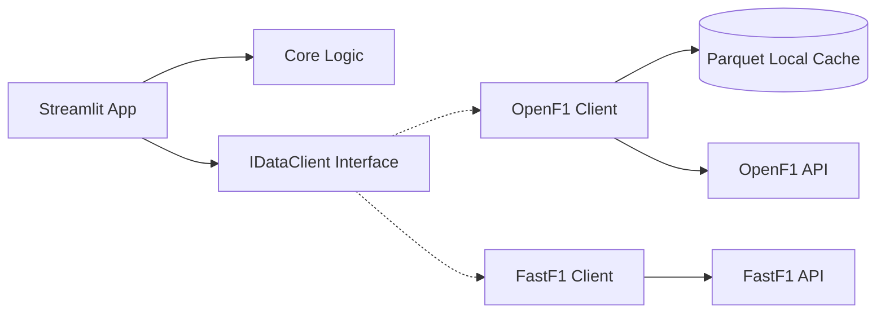
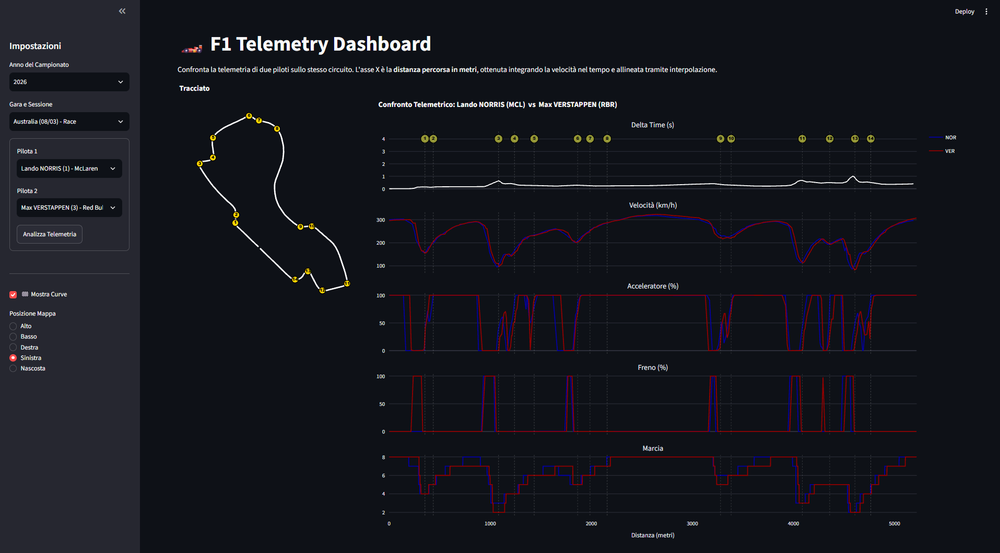
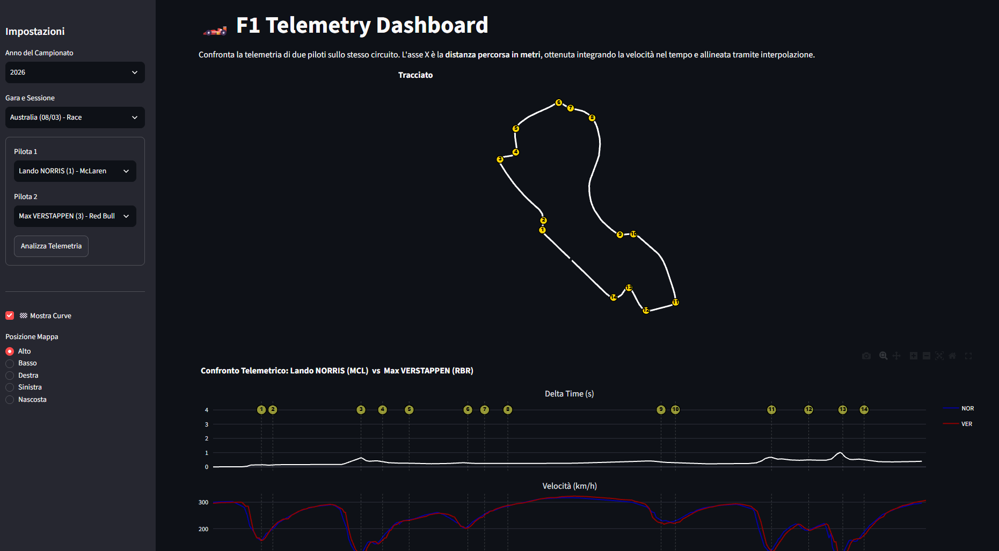
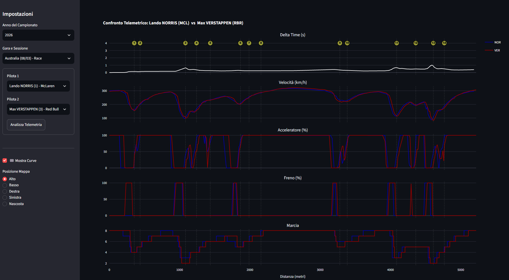

# 🏎️ F1 Telemetry Dashboard

## 1️⃣ Project Overview
An interactive Python-based dashboard for motorsport data analysis. This project solves the problem of inaccessible telemetry by combining raw spatial data with official timing and circuit mapping, allowing users to mathematically compare driver performances on a unified distance grid.

## 2️⃣ Features
- **Spatial Telemetry Alignment:** Compares telemetry based on *distance traveled* (meters) rather than time, allowing for 1:1 corner entry/exit comparisons.
- **Dynamic 2D Track Map:** Renders the actual racing line (GPS coordinates) overlaid with official corner numbers.
- **Multi-Variable Analytics:** Real-time generation of Delta Time, Speed, Throttle, Brake, and Gear usage charts.
- **Smart Filtering:** Automatically filters out cancelled events and provides warnings for unrepresentative Pre-Season tests.
- **Dynamic Layout:** The UI adapts to user preference (Map on the left, right, top, bottom, or hidden).

## 3️⃣ Tech Stack
- **Python 3.11+** - Core language.
- **Streamlit** - For building the interactive Web UI and managing reactive states.
- **Plotly** - For rendering highly performant, multi-axis interactive charts.
- **Pandas & SciPy** - For heavy data manipulation, numeric integration (calculating distance from speed), and signal interpolation.
- **OpenF1 & FastF1** - External data providers for live timing, telemetry, and official circuit mappings.
- **FastParquet** - For high-speed, compressed disk caching.

## 4️⃣ Architecture 🔥
The system is built on **Clean Architecture** principles. The UI does not know where the data comes from; it relies on abstract interfaces.



## 5️⃣ Project Structure
```plaintext
F1Project/
├── src/
│   ├── core/           # Pure mathematical models (telemetry interpolation, distance calculation)
│   ├── interfaces/     # Abstract base classes (IDataClient)
│   ├── infrastructure/ # Concrete API clients implementing the interfaces
│   └── presentation/   # Plotly charting logic decoupled from the UI
├── app.py              # Main Streamlit entrypoint
└── requirements.txt    # Dependencies
```

## 6️⃣ Installation & Setup
**Prerequisites:** Python 3.11+ installed on your machine.

1. **Clone the repository**
```bash
git clone https://github.com/TuoNomeUtente/f1-telemetry.git
cd f1-telemetry
```

2. **Create and activate a virtual environment**
```bash
python -m venv .venv
source .venv/bin/activate  # (On Windows use: .\.venv\Scripts\activate)
```

3. **Install dependencies**
```bash
pip install -r requirements.txt
```

4. **Run the application**
```bash
streamlit run app.py
```

## 7️⃣ Usage
1. Open the application in your browser (`localhost:8501`).
2. Use the sidebar to select the **Championship Year** and the **Session** (chronologically ordered).
3. Select **Driver 1** and **Driver 2** from the grid.
4. Choose your preferred track map layout and click **"Analizza Telemetria"**.
5. Hover over the Plotly charts to compare braking points and throttle application simultaneously.

## 8️⃣ Screenshots / Demo







## 9️⃣ External API Consumption
The project relies on public APIs. No authentication is required.
- **OpenF1 (`https://api.openf1.org/v1/`)**: Used for `/sessions`, `/laps`, `/car_data`, and `/location`. 
- **FastF1**: Used as a fallback and to extract official corner coordinates via `session.get_circuit_info()`.

## 🔟 Engineering Decisions
- **Cache-Aside Pattern:** Raw telemetry for a single lap contains tens of thousands of rows. Making HTTP requests on every UI re-render would block the main thread. We implemented a `.parquet` local caching layer: subsequent loads for the same session drop from ~4 seconds to `< 0.1s`.
- **Distance vs Time Alignment:** Raw telemetry is time-based. To compare two drivers taking a corner at different times, we numerically integrated `Speed (m/s)` over `Time (s)` to get `Distance (m)`, and then applied 1D linear interpolation (`scipy.interpolate.interp1d`) to snap both drivers to a standardized 1-meter spatial grid.
- **Interface Segregation:** By defining `IDataClient`, swapping out OpenF1 for an official commercial API in the future will require zero changes to the `app.py` or `core` logic.

## 1️⃣1️⃣ Limitations & Future Improvements
- **RAM Usage:** Heavy caching in memory via `@st.cache_data` can lead to RAM spikes if multiple full-race sessions are analyzed consecutively.
- **Future Improvement:** Implement a Least-Recently-Used (LRU) cache limit to prevent Out-Of-Memory errors.
- **Future Improvement:** Add weather data integration (track temperature, rain) to contextualize lap times.

---

## ⚖️ Disclaimer & Copyright
This is a personal, educational, and open-source project. This project is unofficial and is not associated in any way with the Formula One group of companies. All data is retrieved from public endpoints (OpenF1 and Fast-F1) purely for non-commercial, academic, and recreational purposes.